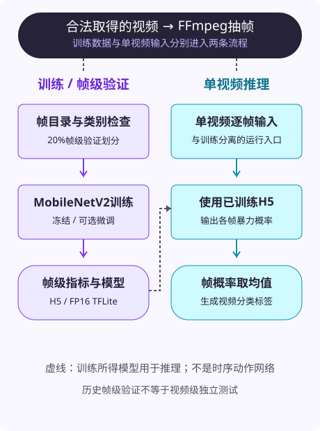

<p align="center"></p>

<h1 align="center">🛡️ 校园暴力视频识别</h1>

<p align="center">MobileNetV2 帧分类与视频概率聚合</p>

<p align="center">   </p>

使用FFmpeg抽取视频帧，以MobileNetV2做Violence / NonViolence二分类，再对单视频的帧概率取均值生成预测。包含Keras训练、评估、视频推理和FP16 TFLite导出脚本。

[代码](src) · [运行说明](docs/RUNNING.md) · [评估口径](docs/EVALUATION.md) · [来源与共同贡献](docs/SOURCES_AND_PERMISSIONS.md)

## 🎞️ 视频与模型流程

<p align="center"></p>

分类头：`MobileNetV2 → GlobalAveragePooling2D → Dense(512, ReLU) → Dropout(0.5) → BatchNormalization → Dense(1, Sigmoid)`。先冻结骨干训练，再可选解冻最后20层微调，BatchNorm保持冻结。入口：[训练](src/04_train_model.py)、[视频推理](src/05_predict_video.py)、[FFmpeg封装](src/ffmpeg_utils.py)。

## 📊 历史帧级验证

训练8418帧、验证2103帧。代码在帧目录上做20%验证切分，未按视频来源隔离，可能包含同源视频帧。以下是保存的本地帧级记录，不是视频级独立测试或竞赛成绩。

| Accuracy | Precision | Recall | F1 | AUC |
|---:|---:|---:|---:|---:|
| 0.9163 | 0.9356 | 0.8994 | 0.9171 | 0.9653 |

混淆矩阵 `[[953, 67], [109, 974]]`，类别顺序为NonViolence、Violence。Accuracy/Precision/Recall/F1的算术一致；缺逐帧概率，AUC未独立复算。原记录见[训练输出](results/train_result.txt)和[预测示例](results/predict_examples.txt)。个别预测示例不能证明整个视频测试集的性能。

## ⚙️ 使用与项目结构

[environment_tf210_py39.yml](environment_tf210_py39.yml)定义Python3.9、TensorFlow2.10.1、Keras2.10.0及FFmpeg环境。数据布局、训练参数和模型位置见[运行说明](docs/RUNNING.md)。单视频推理示例：

```powershell
python src/05_predict_video.py --video "path/to/authorized-example.mp4" --model "models/best_model_finetuned.h5" --fps 1
```

`src/`中01–05脚本对应重封装、抽帧、检查、训练和预测；`scripts/`保存Windows示例。`dataset/`、`frames/`、`fixed_videos/`、`logs/`、`models/`只保留说明，数据与权重不在当前Git文件树中。

## 🛠️ 验证与限制

已核对源码、相对链接和历史指标；没有重新训练、加载TensorFlow模型、实测视频或执行TFLite。TFLite导出不等于开发板部署；PPT中的四路1080P、知识蒸馏、SQLite告警和72小时运行没有对应实现或验收证据。详细检查见[VERIFICATION.md](VERIFICATION.md)。

项目用于学习与实验，预测需要人工复核，不用于自动处罚或身份判断。

## 📦 模型与来源

[既有Releases](https://github.com/Sh-Vacle/campus-violence-recognition/releases)保存历史模型资产，目前仅核对元数据，包内容与分发权仍需确认。数据来源记为Kaggle Real Life Violence Situations Dataset，其使用范围需单独核对。

代码保留[MIT LICENSE](LICENSE)，不延伸授权数据、模型、厂商材料或全部团队方案。共同贡献与AI辅助开发说明见[来源记录](docs/SOURCES_AND_PERMISSIONS.md)。OrangePi手册已从当前分支停止跟踪，旧历史仍保留该文件；参考[厂商支持页](http://www.orangepi.cn/html/hardWare/computerAndMicrocontrollers/service-and-support/Orange-Pi-kunpeng.html)。

[公开文件清单](PUBLIC_FILES_MANIFEST.md) · [排除清单](EXCLUDED_FILES.md)
